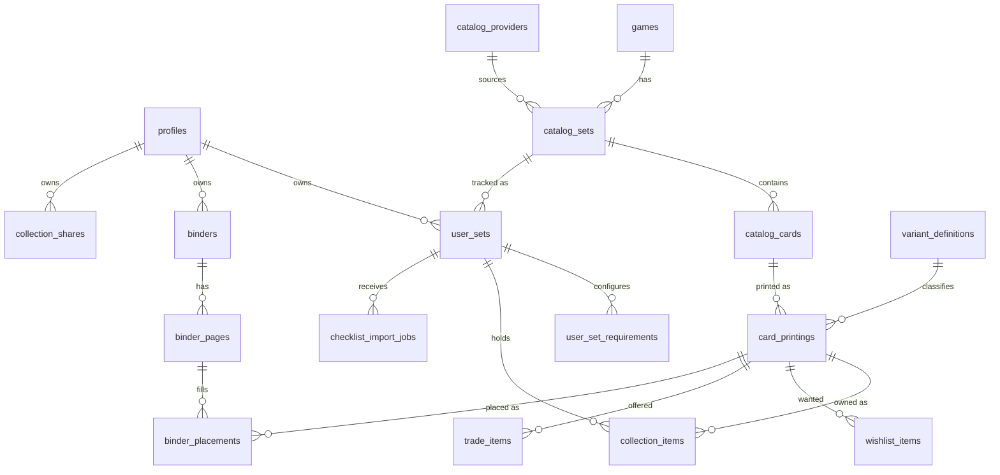

# Database Schema

Source of truth: `supabase/migrations/`. This document explains the model, constraints, RLS and
indexes. Updated 2026-11-04 (milestone 1: `profiles` only; the rest is the agreed target model).

## Implemented

### `public.profiles` — migration `20261104000000_profiles.sql`

| Column | Type | Notes |
| --- | --- | --- |
| `id` | uuid PK → `auth.users(id)` on delete cascade | one row per user |
| `display_name` | text, null or 1–80 chars | shown instead of email where sharing exists |
| `avatar_url` | text ≤ 2048, nullable | Storage URL later |
| `preferences` | jsonb object, default `{}` | UI prefs (clipboard format etc.) |
| `created_at`, `updated_at` | timestamptz | `updated_at` maintained by trigger |

- Trigger `on_auth_user_created` → `handle_new_user()` (SECURITY DEFINER, `search_path = ''`) inserts
  the row, copying `raw_user_meta_data.display_name` if present.
- Trigger `profiles_set_updated_at` → `set_updated_at()` (reused by all later tables).
- Grants: `authenticated` may select/insert/update; `anon` has none.

**RLS**

| Operation | Policy | Rule |
| --- | --- | --- |
| select | owner can select | `(select auth.uid()) = id` |
| insert | owner can insert | `with check (select auth.uid()) = id` |
| update | owner can update | using + with check as above |
| delete | — | none; cascades from `auth.users` only |

Tested by `supabase/tests/database/profiles_rls.test.sql` (pgTAP; **not yet executed**, see
`docs/ROADMAP.md` blockers).

### `public.delete_own_account()` — migration `20261104100000_account_deletion.sql`

SECURITY DEFINER function, `authenticated` only, no arguments. Deletes the caller's `auth.users`
row; `profiles` (and all future owned tables) cascade. Raises `42501` when called without a
session. Irreversible (D-012).

### Catalog layer + user_sets — migration `20261104200000_catalog_and_user_sets.sql`

| Table | Purpose | Ownership / RLS |
| --- | --- | --- |
| `games` | franchise reference data (seeded: Pokémon, Magic, Yu-Gi-Oh!, Lorcana, One Piece, F1, basketball, football, baseball, soccer, other) | public read, no user writes |
| `catalog_providers` | adapter registry with terms/attribution (seeded: tcgdex, scryfall, ygoprodeck as `planned`) | public read |
| `catalog_sets` | provider sets (`provider_id`+`provider_set_id`, `owner_id null`) or custom sets (`owner_id`) | read: shared or own; write: owner only |
| `catalog_cards` | card identity; `sort_key` generated from `number`; trigram index on `name` | mirrors set owner (trigger) |
| `variant_definitions` | per-set taxonomy (`slug` unique per set; `category`; `applies_by_default`) | mirrors set owner |
| `card_printings` | card × variant existence; unique pair; variant must belong to the card's set (trigger) | mirrors card owner |
| `user_sets` | user ↔ catalog set tracking; unique `(user_id, catalog_set_id)` | owner only |
| `user_set_overview` (view) | joined fields + `card_count`, `variant_count`; `security_invoker` | caller's RLS |

Functions: `card_number_sort_key(text)` (immutable), `create_custom_set(...)` (security invoker;
set + `base` variant + tracking row), triggers `catalog_child_sync_owner`,
`catalog_cards_create_default_printings`, `variant_definitions_create_default_printings`.

Indexes: provider keys (partial unique), `(catalog_set_id, sort_key, position)`, owner partial
indexes, `(user_id, status)`, trigram on card name.

### Checklist import — migration `20261104300000_checklist_import.sql`

| Object | Purpose | Ownership / RLS |
| --- | --- | --- |
| `checklist_import_jobs` | one row per committed import: `source` (paste/csv/tsv/json), `strategy` (skip/update/create), `summary` jsonb counts. Raw uploads are never stored. | owner select/insert; no anon |
| `import_checklist(set, source, strategy, cards jsonb, variants jsonb)` | transactional commit of a reviewed plan: upserts variants by slug (non-default), inserts/updates/skips cards per strategy, adds named printings, records the job, returns the summary. SECURITY INVOKER; refuses sets the caller does not own (42501), >5000 cards, empty input (22023). | caller's RLS |

Matching happens client-side (`features/import/domain/plan.ts`); the function re-checks every
`existing_id` under RLS and treats a stale/foreign id as a new card. External ids from a file land
in `catalog_cards.external_ids.import`.

### Collection tracking — migration `20261104400000_collection.sql`

| Object | Purpose | Ownership / RLS |
| --- | --- | --- |
| `collection_items` | ownership per `(user_set_id, printing_id)`: `quantity` 0–9999, `condition` ≤40, `notes` ≤2000. Quantity 0 keeps the row (and its notes). Trigger `collection_items_check_printing` refuses printings from another set. | via `user_sets.user_id`; no anon |
| `user_set_requirements` | include/exclude rules: `scope` ∈ variant_category / variant / card / printing, `target` (uuid or category name), `action`. Unique per `(user_set_id, scope, target)`. | via `user_sets.user_id`; no anon |
| `set_collection_item(user_set, printing, qty?, condition?, notes?)` | upsert with partial patch (`null` leaves a field alone, `''` clears). SECURITY INVOKER. | caller's RLS |
| `user_set_overview` (view, replaced) | adds `printing_count`, `owned_printings` (quantity > 0), `owned_quantity` | caller's RLS |

Completion is **not** stored. `features/collection/domain/requirements.ts` resolves rules (most
specific scope wins, default include) and `completion.ts` counts owned required printings; both
are pure and unit-tested. Indexes: `collection_items (printing_id)` plus the unique pair.

## Target model (phases 2–8)

### Entity intent (one line each)

- **games** — franchise (Pokémon, MTG, F1 Topps…). Public read.
- **catalog_providers** — adapter registry with terms/attribution text. Public read.
- **catalog_sets / catalog_cards** — shared metadata. Provider-sourced rows are public read;
  **custom rows carry `owner_id`** and are visible only to their owner (RLS `owner_id is null or
  owner_id = auth.uid()`), which resolves the "custom checklist ownership" question in the blueprint
  without duplicating provider data per user.
- **variant_definitions** — per game/set taxonomy (holo, reverse, 1st edition, parallel name,
  serial…). No universal enum.
- **card_printings** — a concrete collectible: card × variant definition (+ language, edition).
  Ownership, wishlist, trade and placements all reference printings so "duplicates" and "multiple
  variants" are independent rows.
- **user_sets** — a user tracking a catalog set or a custom set; unique `(user_id, catalog_set_id)`
  where not null.
- **user_set_requirements** — implemented (see above). Language/edition constraints are expressed
  through variant categories; a dedicated language scope can be added if provider data needs it.
- **collection_items** — implemented (see above). Status (owned / wanted / for-trade) is **not** a
  column here; wishlist and trade are separate tables so quantities don't become ambiguous.
- **wishlist_items / trade_items** — per printing, quantity + notes; trade quantity ≤ owned is
  enforced in domain code with a DB check where feasible.
- **binders / binder_pages / binder_placements** — `pages (binder_id, page_order)` unique; `rows`,
  `columns` per page with limits; placements `(page_id, slot_index)` unique, `slot_index <
  rows*columns` enforced by a trigger that reads the page; placement optional
  `collection_item_id`; empty slots are *absent rows* (sparse) — the UI derives slot identity from
  index.
- **collection_shares** — `token_hash` (sha-256 of a random token), scope, expiry, `revoked_at`;
  read via a SECURITY DEFINER function returning only whitelisted fields.
- **checklist_import_jobs** — implemented (see above); mapping is not persisted yet.
- **user_set_notes** — implemented in `20261104600000_set_notes_and_card_order.sql` (phase 7):
  timestamped free text per tracked set, owner-only via `user_sets`. The same migration adds
  `catalog_sets.card_order` ('number' | 'manual'; exposed on `user_set_overview`) and
  `reorder_catalog_cards(set, ids[])`, which rewrites `catalog_cards.position` from a complete
  ordered id list under the caller's RLS (so only a custom set's owner can reorder).
- **Checklist Library** — implemented in `20261104700000_checklist_library.sql` (phase 8):
  `catalog_sets.visibility` ('private' | 'public') + `published_at`. Catalog read access for a
  signed-in user is now: provider rows, own rows, public sets, and sets the user already tracks
  (child tables go through `catalog_set_readable()`, SECURITY DEFINER, so unpublishing never strands
  a collector). A trigger (`catalog_set_trackable()`) refuses `user_sets` rows for sets the caller
  cannot read, closing the "track a guessed uuid to gain access" hole. `checklist_library` view runs
  as its owner (no security_invoker) and exposes only whitelisted columns of public sets plus a
  publisher display name (never email). RPCs: `set_catalog_set_visibility` (owner),
  `track_catalog_set` (idempotent), `duplicate_catalog_set` (private copy of any readable set:
  set, variants, cards, printings; no ownership). `user_set_overview` gains `visibility` and
  `other_tracker_count`.
- **binders / binder_pages / binder_placements** — implemented in migration
  `20261104500000_binders.sql` (phase 6). Sparse placements: a filled slot is a row, an empty slot
  is no row; `slot_index = row * columns + col`. Unique `(page_id, slot_index)` (non-deferrable,
  the client upserts on it); unique `(binder_id, page_order)` deferrable so `reorder_binder_pages`
  can renumber in one statement. Triggers: a placement must fit its page; shrinking a page under
  placements directly is refused. RPCs (SECURITY INVOKER, RLS applies): `create_binder` (binder +
  first pages), `resize_binder_page` (coordinate remap, deletes what no longer fits, returns the
  count), `reorder_binder_pages`, `duplicate_binder_page` (copies placements, shifts later pages),
  `generate_binder_pages` (auto-layout from a printing list, ≤ 5000). View `binder_overview`
  (security_invoker) adds page/placement/slot counts. `collection_item_id` is nullable and set null
  when the item goes, so a placement never depends on ownership.

### RLS matrix (target)

| Table | anon | authenticated owner | other users |
| --- | --- | --- | --- |
| games, catalog_providers | read | read | read |
| catalog_sets/cards/printings (provider) | read | read | read |
| catalog_sets/cards/printings (custom, `owner_id`) | — | CRUD | — |
| user_sets, requirements, collection_items, wishlist, trade | — | CRUD | — |
| binders → pages → placements | — | CRUD via parent ownership | — |
| collection_shares (not built; share links parked 2026-11-04) | via token function only | CRUD | via token function only |
| catalog_sets/cards/printings (custom, published) | — | CRUD | read while public, or while already tracked |
| profiles | — | select/insert/update | — |

Child tables derive authorization from the parent (`exists (select 1 from binders b where b.id =
binder_id and b.user_id = auth.uid())`), never from a user-supplied `user_id`.

Note on grants: the hosted Supabase project has default privileges that grant `anon` and
`authenticated` table-level access to every new object in `public`, so `anon` can *address* tables
such as `user_sets` and the `user_set_overview` view. RLS is the control that matters: with no
`anon` policy those reads return an empty set and writes fail with 42501 (verified over REST,
2026-11-04). The explicit `grant`/`revoke` statements in migrations are belt-and-braces, not the
security boundary (CLAUDE.md: "frontend filters are not security" applies to grants as well).

### Index plan

- `catalog_sets (provider_id, provider_set_id)` unique where provider_id not null; `(game_id)`.
- `catalog_cards (catalog_set_id, number)`; trigram index on `name` for search.
- `card_printings (catalog_card_id)`, `(variant_definition_id)`.
- `user_sets (user_id)`, `collection_items (user_set_id)`, `(printing_id)`.
- `binder_pages (binder_id, page_order)` unique; `binder_placements (page_id, slot_index)` unique,
  `(printing_id)`.
- `collection_shares (token_hash)` unique; partial index on `revoked_at is null`.
- `checklist_import_jobs (user_id, status)`.

### Completion

One domain function (`features/collection/domain/completion.ts`, phase 4): resolve active
requirements → enumerate required printings → look up owned quantities → classify
complete / partial / missing / excluded → percentage. Never persisted as a source of truth.
